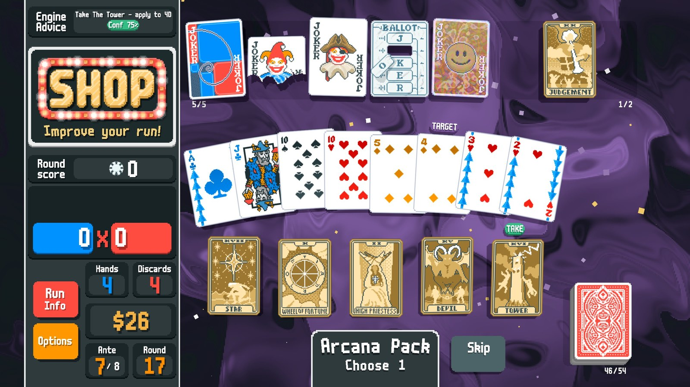

# Balatro Engine Sim — Decision Assistant & Self-Player

A Balatro mod (Steamodded + Lovely) that reads the live game state and recommends the best move — what to
play, discard, buy, sell, reroll, skip, pick from a pack, and which consumables to use — with a reason for
each. It can also **play whole runs by itself** (F11), restarting finished runs automatically (F6), which is
how its advice is tested in the real game.

Every recommendation comes from **measuring** options against your actual deck and board (Monte-Carlo over
real hands, scored by a faithful re-implementation of Balatro's scoring), not from fixed tier lists.



*Unofficial fan project. Not affiliated with or endorsed by Playstack or LocalThunk, and it ships no game code or
assets. It is a single-player aid and self-player: don't use it in Balatro Multiplayer or any competitive setting
(see [Known limits](#known-limits)).*

## Status

- **Autonomous win rate:** about **41%** in the headless simulator (red deck, white stake; 66 of 160 on the seed_off-7 pool,
  18 October 2026). The simulator is this project's own model of the game's rules, so that is **not** a measured
  in-game win rate; the live numbers below are the real ones. For scale: ~28% at the start of October, ~6% in late
  September 2026 and ~1% in August.
- **Live:** the in-game self-player plays unattended overnight (watchdog + auto-restart); recent nights won 9/26 and 4/26
  runs. Its runs are reviewed to find live-only bugs (press F5 at a misplay to save the decision for review).
- **Recent (Oct 2026):** the simulator is ~9x faster (hand scoring compiled by LuaJIT, exact pruning of plays that can't be
  best; a 160-seed A/B now takes ~70 min); in-blind money farming of money jokers (`engine/farm.lua`); Idol / Ancient /
  Castle / Mail-In round targets read live; a shallow look-ahead search at early shops (`sim/lookahead.lua`, sim-only,
  tested and closed: no gain at this depth). Measured: +$10/round money lifts the sim win rate 36% -> 81%, but forcing
  money jokers does not pay.
- **Tests:** 1666 headless unit tests + 637 simulator-suite tests, all green.
- The full, current handoff (what shipped, what was measured, what's next) is in **`NEXT_SESSION.md`**.

## About this project

This took a lot of sustained effort: about eleven weeks (August–October 2026), 59 working days, 800+ commits, roughly
48,000 lines of Lua (about 11,000 of them tests), hundreds of paired simulation experiments and a stack of live
runs reviewed by hand, decision by decision. Most of what is in the repo is the *measurement* — which ideas helped,
which didn't, and why — and the negative results are kept on purpose (`docs/archive/CLAUDE_HISTORY.md`,
`docs/GRAND_AUDIT.md`), so nobody has to re-try a dead end.

The win rate has been flat for a while: the big levers (shop, economy, in-blind play) have mostly been measured and
exhausted, and the remaining gap is build assembly and supply. If you want to pick it up, `NEXT_SESSION.md` and the
Known limits below are the honest starting point.

## What it advises

- **Play / discard** — the best play for this blind on a survival objective, and discards that *dig*
  toward the hand your jokers reward (measured on real redraws, board-aware), including economy discards
  (Faceless, Mail-In Rebate, Trading Card, Burnt Joker levelling, Sixth Sense) and card order (Hanging
  Chad, Photograph, ×mult placement).
- **Shop** — buy / sell / reroll / save in one currency with an interest-aware bankroll plan; jokers valued
  by measured scoring now and projected to mid-run (deck and level growth); swaps on a full board; vouchers
  valued by what they do for this run; buys that a reroll would replace are made first.
- **Packs** — which card to take and in what order: planets by the hands you actually play, tarots and
  spectrals by their measured effect on your deck (targets named from your drawn hand), Standard-pack cards
  by a paired with/without measurement plus seal/edition value, jokers against your board (with the
  make-room sale when full).
- **Blind select** — skip for a tag vs play, including Riff-Raff/Cartomancer-style generators.
- **Pacing** — whether the board is on pace for ante 8, which tilts economy vs power.

## In-game keys

| Key | Action |
|---|---|
| F5 | Flag a misplay: saves the last 4 decisions to `bes_flagged.jsonl` for review (a lost run saves its last 12 automatically) |
| F6 | Auto-restart on/off (with self-play on, a finished run restarts after 4 s via the game's hold-R path) |
| F7 | Dump owned jokers' live `ability` tables (`bes_joker_dump.txt`), tagged scored / value-only / UNCOVERED |
| F8 | Force a re-evaluation |
| F9 | Show / hide the panel |
| F10 | Capture-only mode (log decisions, no evaluation) |
| F11 | Self-play on/off |

The advice panel sits at the top of the left HUD (hover it for the reason, stats and Self-play / Auto-restart status), and a tag marks the recommended card, shop item or button. Pack choices show "Evaluating pack…"
until the measured decision is ready.

## Install

1. Install [Lovely](https://github.com/ethangreen-dev/lovely-injector), then
   [Steamodded](https://github.com/Steamodded/smods).
2. **r2modman (recommended):** build the package with `python tools/package_r2.py` and add
   `dist/Anto640-EngineSim-<version>.zip` through r2modman's *Import local mod*. **Plain Lovely install:** copy the
   mod files (`main.lua`, `your_mod.json`, `config.lua`, `core/`, `engine/`, `model/`, `ui/`, `util/`) into
   `%APPDATA%/Balatro/Mods/balatroenginesim/`.
3. Start a run; the panel appears in the HUD.

Telemetry is written to the LÖVE save folder (`%APPDATA%/Balatro/`): `bes_runs.jsonl` (the run),
`bes_fixtures.jsonl` (the full game state at every decision, for replaying misplays through the engine) and
`bes_autoplay.log` (what the self-player did).

## Development

The engine is **pure**: `core/state_extraction.lua` is the only file that reads the game; everything in
`engine/` is a function of plain Lua tables, so it runs and is tested headless.

```sh
lua tests/runner.lua                          # unit tests (no game needed)
luajit tests/runner_sim.lua                   # simulator integration tests
bash tools/sim_par.sh 160 <name>              # self-play batch across all cores -> sim_out/<name>.jsonl
lua tools/analyze_runs.lua sim_out/<A>.jsonl compare sim_out/<B>.jsonl   # paired A/B verdict
```

The simulator (`sim/`) drives the real engine through whole runs with the same telemetry as the live mod and
is deterministic per seed across processes, so A/B comparisons are paired and parallel batches are exact.
`tools/README.md` indexes the analysis tools.

## Layout

```
core/     state_extraction (reads G), run telemetry, replay fixtures, change signatures
model/    game_state / shop_state PODs
engine/   hand_eval (scoring), joker_effects / joker_data / joker_value (measured jokers),
          eval_function (run strength, forward valuation), decision_engine / discard_value /
          ordering / simulation (in-blind play), shop_advisor, pack_open_advisor, consumable_value,
          tarot, packs, vouchers, tags, skip_advisor, build_plan, pacing, boss_effect, ...
ui/       advice state (overlay), native HUD panel, in-world highlights, autoplay (the self-player)
sim/      world (rules referee), content (shops/packs/tags), driver (run loop)
tools/    batch runners, analysis and replay tools (see tools/README.md)
tests/    headless unit + simulator suites
```

## Docs

| File | What it is |
|---|---|
| `NEXT_SESSION.md` | Current state, recent results and the prioritised next steps — start here |
| `CLAUDE.md` | Working guide: architecture rules, workflow, measurement rules, gotchas |
| `docs/ADVICE_REVIEW.md` | Live-run misplays reported by the owner and how each was fixed |
| `docs/GRAND_AUDIT.md` | Deep audit of the win-rate investigation (historical, still referenced) |
| `DESIGN.md` | Original design baseline (historical) |
| `docs/archive/` | Superseded plans |

## Known limits

- The engine reads face-down cards under some bosses (the Wheel, the House, …) — an information advantage
  it has no hidden-information model to avoid.
- The main open problem is **build assembly**: valuing a board as a set (copiers × ×mult × triggers) rather
  than as a sum of individual jokers.
- A green headless suite is necessary but not sufficient: fields marked `-- VERIFY` in
  `core/state_extraction.lua` depend on the game version and are confirmed only in-game.
- Tested on Steamodded and Lovely as installed through r2modman. Other mod setups and game versions may need
  fixes.

## Credits & support

Built by **Anto640** together with **Claude** (Anthropic): Anto640 set the goals, played and reviewed the live runs,
and decided what to keep or revert; Claude Code wrote most of the code, tests and docs. `CLAUDE.md` is the working
guide used for that collaboration and doubles as a contributor guide.

Maintenance is sporadic and there is no promise of support. Issues and pull requests are welcome but may wait.
Released under the [MIT License](LICENSE).
