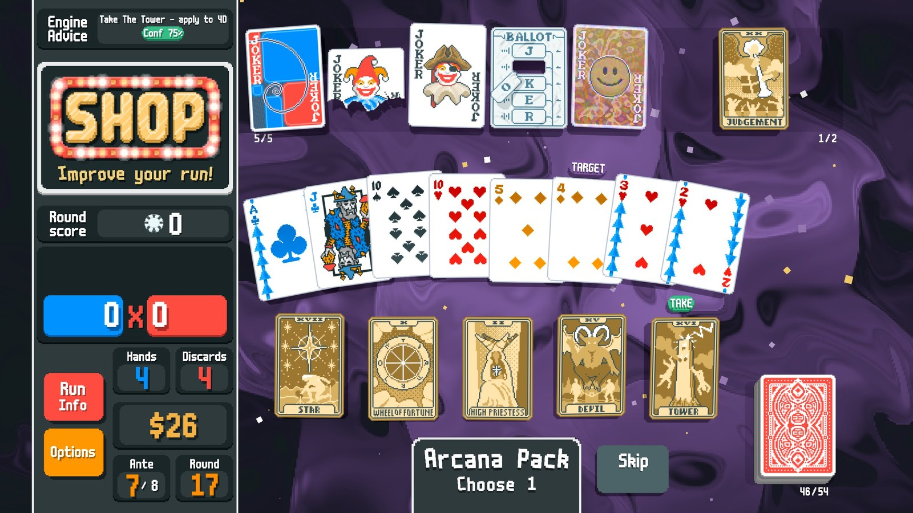

# Engine Sim — Decision Assistant & Self-Player

Engine Sim reads your live game and recommends the best move, with a reason: what to play or discard, what to buy,
sell or reroll in the shop, which pack card to take, whether to skip a blind, and which consumables to use. It can
also **play whole runs by itself**.

Every recommendation comes from **measuring** the options against your actual deck and jokers (Monte-Carlo over real
hands, scored by a re-implementation of Balatro's scoring), not from a fixed tier list.

## How to use it

Start a run. The advice panel sits at the top of the left HUD; hover it for the reason and stats. A small tag marks
the recommended card, shop item or button.

| Key | Action |
|---|---|
| F9 | Show / hide the panel |
| F11 | Self-play on/off (the mod plays the run on its own advice) |
| F6 | Auto-restart on/off (with self-play on, a finished run restarts after 4 s) |

Settings (panel, tags, self-play speed): **Mods → Engine Sim → Config**.

Optional: with [Handy](https://thunderstore.io/c/balatro/p/SleepyG11/Handy/) installed, self-play skips animations
and runs much faster. Without it, self-play still works at normal speed.

## How good is it?

- In its own headless simulator (Red Deck, White Stake) it wins about **41%** of runs. That simulator is the
  project's model of the game, so treat it as a rough figure, not an in-game win rate.
- Playing unattended in the real game, recent nights won 9 of 26 and 4 of 26 runs.
- It is strongest at in-blind play and weakest at assembling a build (valuing jokers as a set).

## Good to know

- **Single-player only.** Don't use it in Balatro Multiplayer or any competitive setting. Under some bosses it can
  read face-down cards, which a human player can't.
- It writes logs to your save folder (`%APPDATA%/Balatro/`): `bes_runs.jsonl`, `bes_fixtures.jsonl` and
  `bes_autoplay.log`. They stay on your PC and are only used to review its decisions.
- Unofficial fan project. Not affiliated with or endorsed by Playstack or LocalThunk; it ships no game code or assets.
- Built by Anto640 together with Claude (Anthropic), which wrote most of the code. It is open source (MIT):
  [github.com/Anto640/balatro-engine-sim](https://github.com/Anto640/balatro-engine-sim).

Maintenance is sporadic. Bug reports are welcome on GitHub but may wait.
